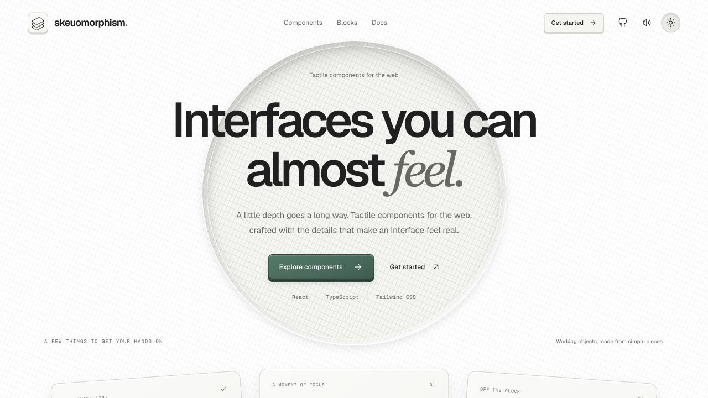
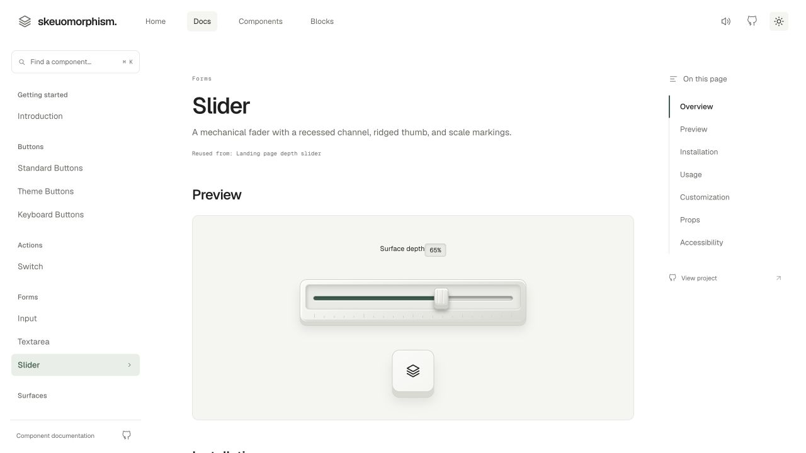
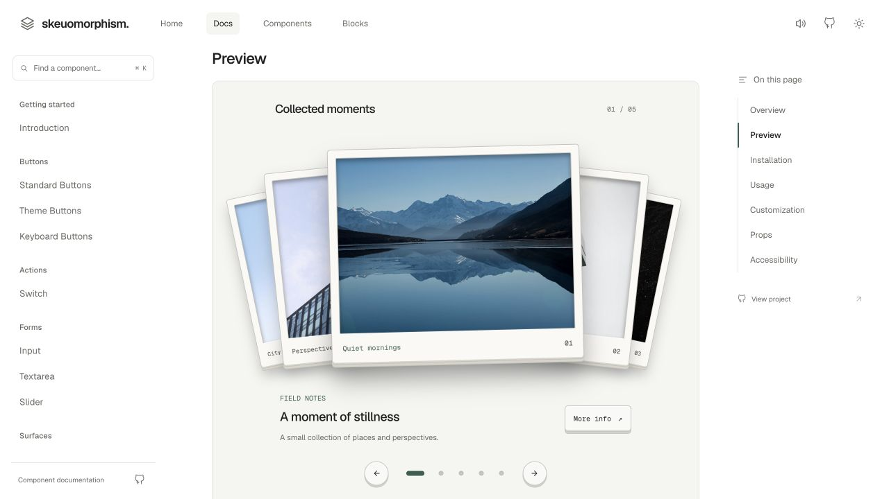

<div align="center">

# Skeuomorphism UI

**Interfaces you can almost feel.**

Tactile React components with raised edges, recessed surfaces, and controls that feel physical.
Install through the shadcn CLI, then make the source your own.

[Website](https://skeuomorphismui.vercel.app/) · [Documentation](https://skeuomorphismui.vercel.app/docs) · [Components](https://skeuomorphismui.vercel.app/docs#components) · [Installation](https://skeuomorphismui.vercel.app/docs#getting-started)

[](LICENSE)
[](https://react.dev/)
[](https://www.typescriptlang.org/)

</div>

<picture>
  <source media="(prefers-color-scheme: dark)" srcset="docs/images/landing-dark.png" />
  
</picture>

## A little depth goes a long way

Skeuomorphism UI is a collection of React components built around familiar materials and physical feedback: mechanical keys, inset fields, layered cards, and photographic prints.

- **Source you own.** The shadcn registry copies component files into your project. Edit them freely.
- **Styles included.** Each item brings its required native CSS, local icons, and component dependencies. Portable components do not require the documentation website’s styles or Tailwind setup.
- **Light and dark themes.** Follow your app’s theme convention or use an optional local provider.
- **Familiar color tokens.** Use `--primary`, `--secondary`, `--card`, `--ring`, and other semantic tokens. Fine-tune materials with `--sk-*` overrides.
- **Replaceable content.** Bring your own photos, portraits, icons, quotes, and data.
- **Optional sound.** Components are silent by default. Connect your own click playback when you want it.
- **Keyboard interaction.** Native controls, visible focus states, and keyboard navigation for tabs, docks, and calendars. Motion-heavy components include reduced-motion handling.

## Quick start

Use a React project with CSS-import support and a configured shadcn `components.json`. If you have not initialized shadcn yet:

```bash
npx shadcn@4.22.1 init
```

Install your first component:

```bash
npx shadcn@4.22.1 add https://skeuomorphismui.vercel.app/r/skeuo-button.json
```

Then use it:

```tsx
import { SkeuoButton } from "@/components/ui/skeuo-button";

export function SaveButton() {
  return <SkeuoButton variant="primary">Save changes</SkeuoButton>;
}
```

The CLI respects your configured UI directory. Adjust the import alias if your project uses a different one. Prefixed filenames such as `skeuo-button.tsx` coexist with an existing shadcn `button.tsx`.

For state and event handlers in Next.js, use a client component. No npm library package or mandatory provider is needed.

**[Read the installation guide →](https://skeuomorphismui.vercel.app/docs#getting-started)**

## The collection

There are **19 installable registry items**. Input and textarea share one item.

| Category | Components |
| --- | --- |
| Buttons | [Standard Button](https://skeuomorphismui.vercel.app/docs/button), [Theme Button](https://skeuomorphismui.vercel.app/docs/theme-button), [Keyboard Button](https://skeuomorphismui.vercel.app/docs/keyboard-button) |
| Controls | [Switch](https://skeuomorphismui.vercel.app/docs/switch), [Input](https://skeuomorphismui.vercel.app/docs/input), [Textarea](https://skeuomorphismui.vercel.app/docs/textarea), [Slider](https://skeuomorphismui.vercel.app/docs/slider), [Tabs](https://skeuomorphismui.vercel.app/docs/tabs) |
| Surfaces and navigation | [Surface](https://skeuomorphismui.vercel.app/docs/surface), [Section Dock](https://skeuomorphismui.vercel.app/docs/section-dock) |
| Cards and compositions | [Project Card](https://skeuomorphismui.vercel.app/docs/project-card), [ID Card](https://skeuomorphismui.vercel.app/docs/id-card), [Contribution Calendar](https://skeuomorphismui.vercel.app/docs/contribution-calendar), [Contact Form](https://skeuomorphismui.vercel.app/docs/contact-form), [Experience Tabs](https://skeuomorphismui.vercel.app/docs/experience-tabs) |
| Interactive pieces | [Focus Timer](https://skeuomorphismui.vercel.app/docs/focus-timer), [Photo Carousel](https://skeuomorphismui.vercel.app/docs/photo-carousel), [Testimonial Carousel](https://skeuomorphismui.vercel.app/docs/testimonial-carousel) |
| Optional utilities | [Theme Provider](https://skeuomorphismui.vercel.app/docs/provider), [Sound Provider](https://skeuomorphismui.vercel.app/docs/sound-provider) |

Every component page includes a live preview, installation command, usage example, props, and accessibility notes.

### A closer look

[](https://skeuomorphismui.vercel.app/docs/slider)

[](https://skeuomorphismui.vercel.app/docs/photo-carousel)

## Make it yours

Existing modern shadcn palettes work through semantic CSS variables. Use complete CSS colors such as hex, `rgb()`, or `oklch()`:

```css
:root {
  --primary: #365e50;
  --primary-foreground: #ffffff;
  --secondary: #eeeeeb;
  --secondary-foreground: #202020;
}

.dark {
  --primary: #9ab5a6;
  --primary-foreground: #14251c;
  --secondary: #292a29;
  --secondary-foreground: #efefeb;
}
```

Highlights and shaded bases follow supplied colors. Without host tokens, the original light and dark material defaults remain in place. The library does not overwrite your host palette or apply a global reset.

For a local palette, install the optional provider:

```bash
npx shadcn@4.22.1 add https://skeuomorphismui.vercel.app/r/skeuo-provider.json
```

```tsx
import { SkeuoProvider } from "@/components/ui/skeuo-provider";
import { SkeuoButton } from "@/components/ui/skeuo-button";

export function CustomPalette() {
  return (
    <SkeuoProvider
      style={{ "--primary": "#6d3546", "--primary-foreground": "#ffffff" }}
    >
      <SkeuoButton variant="primary">Your finishing touch</SkeuoButton>
    </SkeuoProvider>
  );
}
```

See the [theme provider docs](https://skeuomorphismui.vercel.app/docs/provider) and [theming guide](docs/theming.md) for the full token mapping, scoped overrides, and precedence. Choose foreground/background pairs with readable contrast when creating a custom theme.

## What your application supplies

- **Contact form:** your own asynchronous submission callback and backend. Demo forms do not send email.
- **Contribution calendar:** contribution data; no GitHub credentials or fetching are bundled.
- **Cards and carousels:** your own images, alt text, and content. Website demo assets are not installed.
- **Theme button:** your theme state and change handler. Your application owns persistence.
- **Click sounds:** your playback callback, audio assets, and user preference through the optional sound provider.

## Run the website locally

```bash
git clone https://github.com/gavin100305/skeuomorphism-lib.git
cd skeuomorphism-lib
npm ci
npm run registry:build
npm run dev
```

Open [localhost:3000](http://localhost:3000). To use another port, run `npm run dev -- --port 3001`.

| Command | Purpose |
| --- | --- |
| `npm run dev` | Start the documentation website |
| `npm run registry:build` | Generate installable JSON under `public/r/` |
| `npm run build` | Regenerate the registry and build the production website |
| `npm start` | Serve the production website |
| `npm run lint` | Run ESLint |

The website uses Next.js App Router, React, TypeScript, and Tailwind CSS. Installable components use React and their own native CSS.

```text
src/components/skeuomorphic/  Reusable components and scoped styles
src/data/                    Documentation metadata and examples
src/app/                     Website routes
registry.json                Registry manifest
public/r/                    Generated registry items
docs/                        Architecture, theming, and registry guides
```

Edit the canonical components and regenerate registry files; do not edit generated JSON directly. See [component independence](docs/component-independence.md) and [registry maintenance](docs/registry.md) for details.

## Feedback and contributions

Found a bug, an installation issue, or an idea for a component? [Open an issue](https://github.com/gavin100305/skeuomorphism-lib/issues). Include the component name, framework, browser, and a small reproduction where possible.

Built by [Gavin Soares](https://github.com/gavin100305).

## License

Project code is available under the [MIT License](LICENSE). Copyright © 2026 Gavin Soares.
Third-party images, logos, audio, and dependencies retain their respective licenses.
