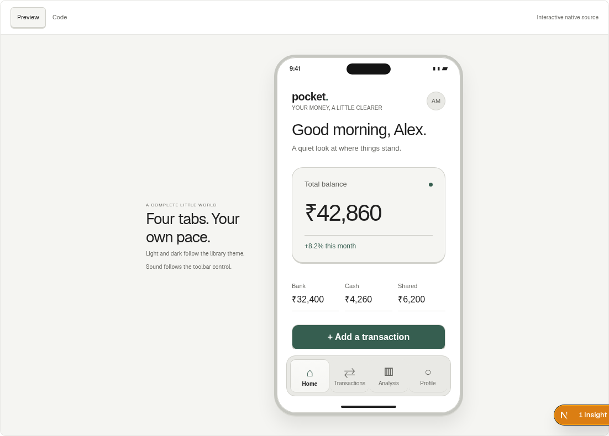
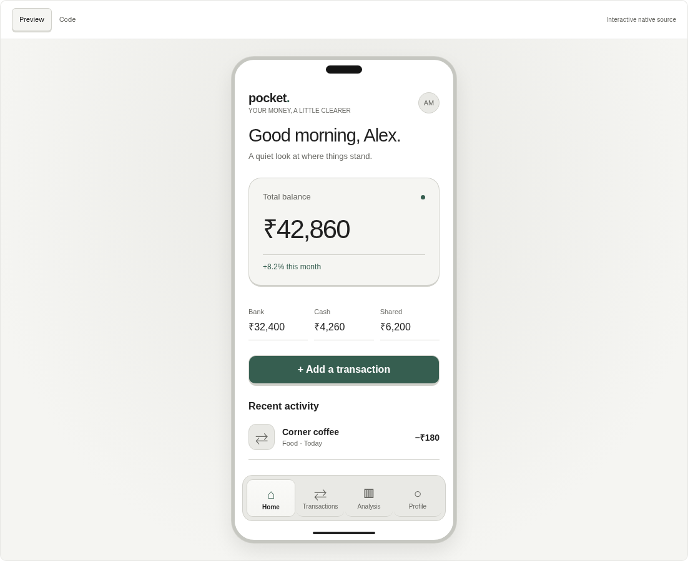
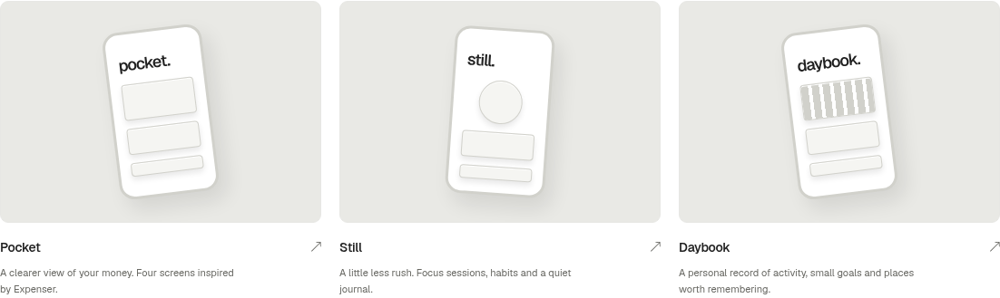
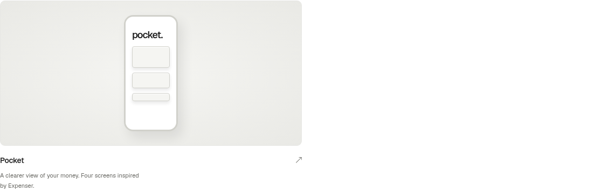

# Mobile redesign

## Pocket preview

The previous preview had a fixed-height screen, a wide status strip and a caption competing with the phone. The new preview centers a 9:19.5 handset on a quiet surface. It scales to the page width and keeps app content scrollable inside the screen.

| Before | After |
| --- | --- |
|  |  |

## Mobile templates

Pocket is the single featured template. It has Home, Transactions, Analysis and Profile screens. The templates page gives it a full-width feature tile instead of a three-card grid.

| Before | After |
| --- | --- |
|  |  |

The mobile catalog and Expo showcase also hide the three alternate bottom bars and the habit-list block. The dock stays featured. Published registry URLs and direct documentation links remain available for existing users.

## Browser checks

The production Next.js build and Expo web export passed. The browser suite checked all 26 direct previews, Pocket’s transaction and balance updates, the dark-mode bridge, and horizontal overflow at 320, 390, 768 and 1280 pixels. The 390-pixel check also measured the handset ratio.
