# Mobile website report

Pocket now has a full-width live showcase, with setup and usage underneath. The templates gallery gives its single template a full-width feature. Small components such as Badge use a compact canvas with installation alongside it on laptops. At narrower widths, the documentation stacks in reading order.

The Web and Mobile switch lives in the docs and template galleries. Switching platforms clears the sidebar search so entries from the new collection are visible. The landing header no longer includes the switch.

## Full-page screenshots

Captured from the production build at a 1366 × 900 laptop viewport and a 390 × 844 mobile viewport. The images run to the bottom of each page.

### Landing

`/`

| Viewport | Light | Dark |
| --- | --- | --- |
| Laptop | [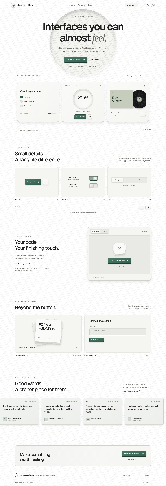](docs/mobile-redesign/report/home-laptop-light.png) | [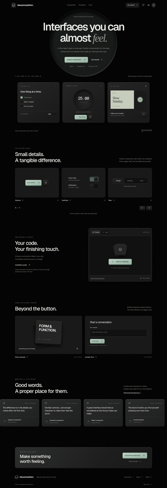](docs/mobile-redesign/report/home-laptop-dark.png) |
| Mobile | [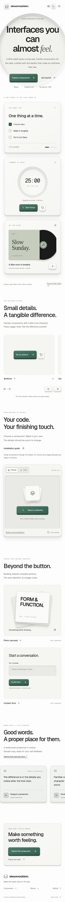](docs/mobile-redesign/report/home-mobile-light.png) | [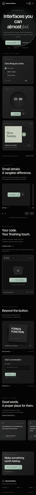](docs/mobile-redesign/report/home-mobile-dark.png) |

### Mobile components

`/docs/mobile`

| Viewport | Light | Dark |
| --- | --- | --- |
| Laptop | [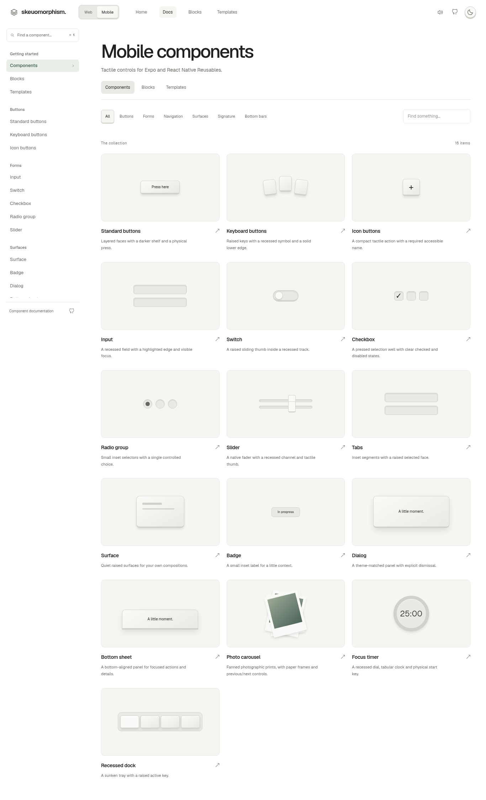](docs/mobile-redesign/report/components-laptop-light.png) | [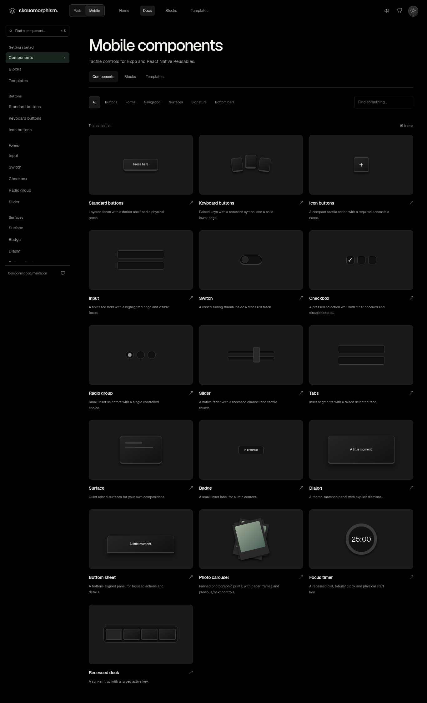](docs/mobile-redesign/report/components-laptop-dark.png) |
| Mobile | [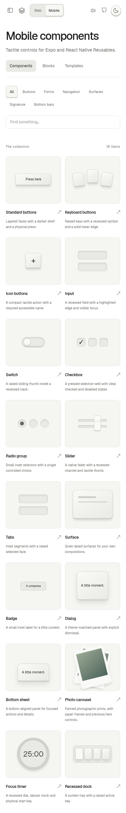](docs/mobile-redesign/report/components-mobile-light.png) | [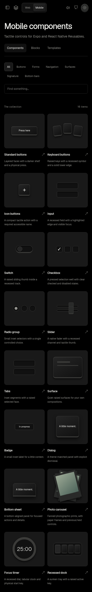](docs/mobile-redesign/report/components-mobile-dark.png) |

### Mobile templates

`/templates/mobile`

| Viewport | Light | Dark |
| --- | --- | --- |
| Laptop | [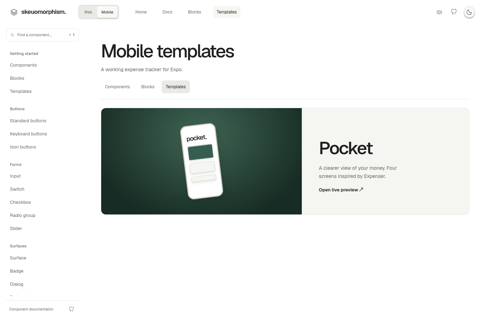](docs/mobile-redesign/report/templates-laptop-light.png) | [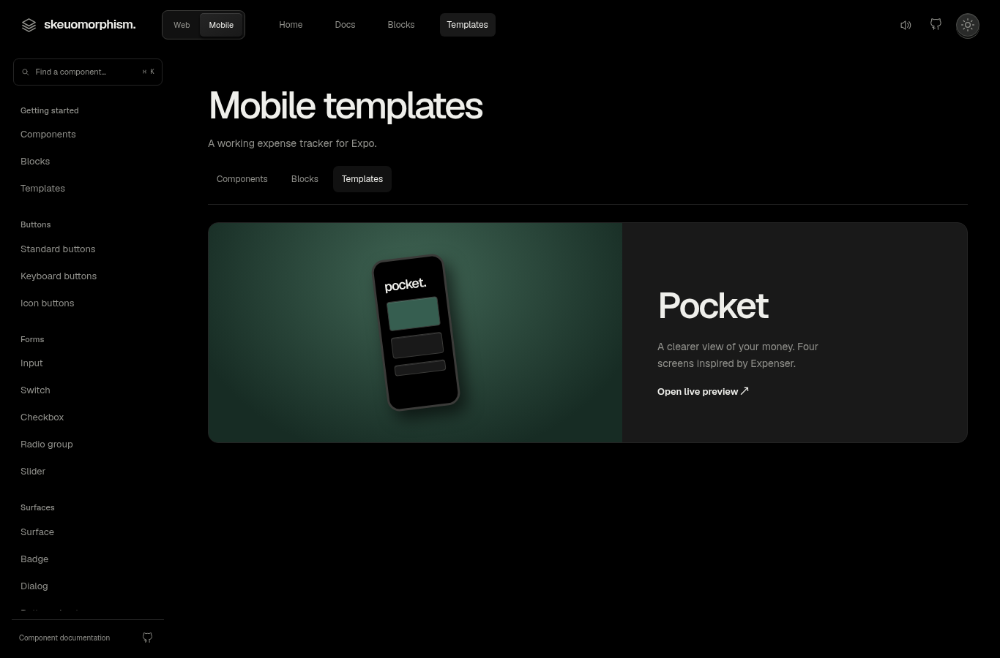](docs/mobile-redesign/report/templates-laptop-dark.png) |
| Mobile | [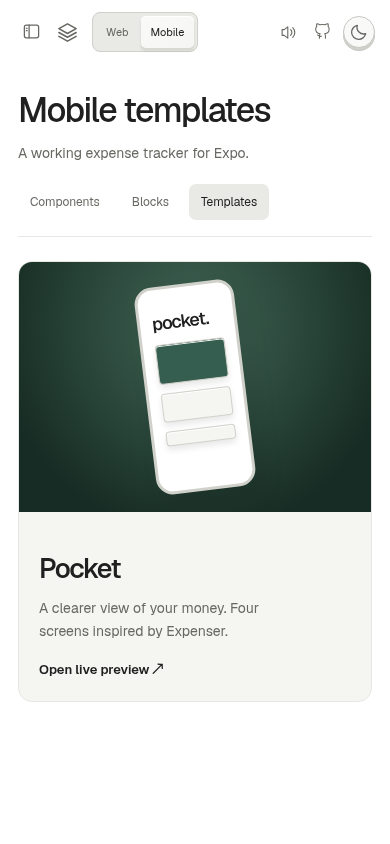](docs/mobile-redesign/report/templates-mobile-light.png) | [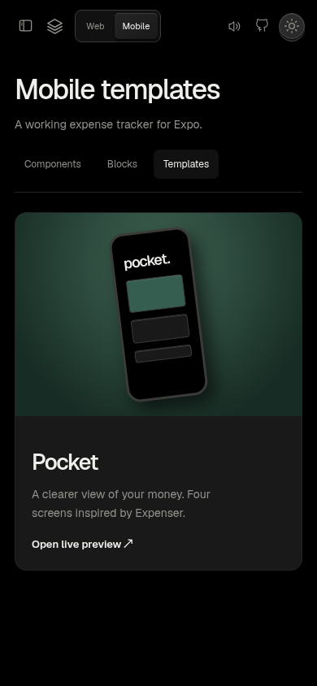](docs/mobile-redesign/report/templates-mobile-dark.png) |

### Pocket

`/docs/mobile/pocket`

| Viewport | Light | Dark |
| --- | --- | --- |
| Laptop | [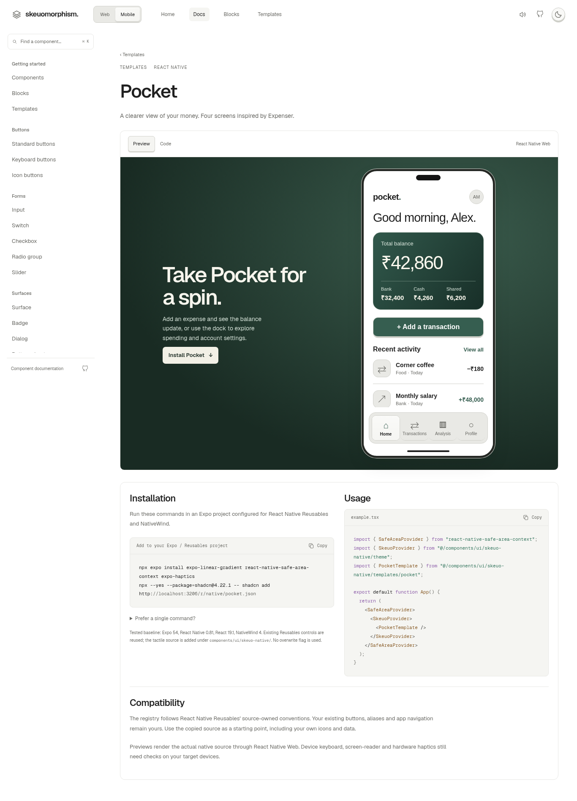](docs/mobile-redesign/report/pocket-laptop-light.png) | [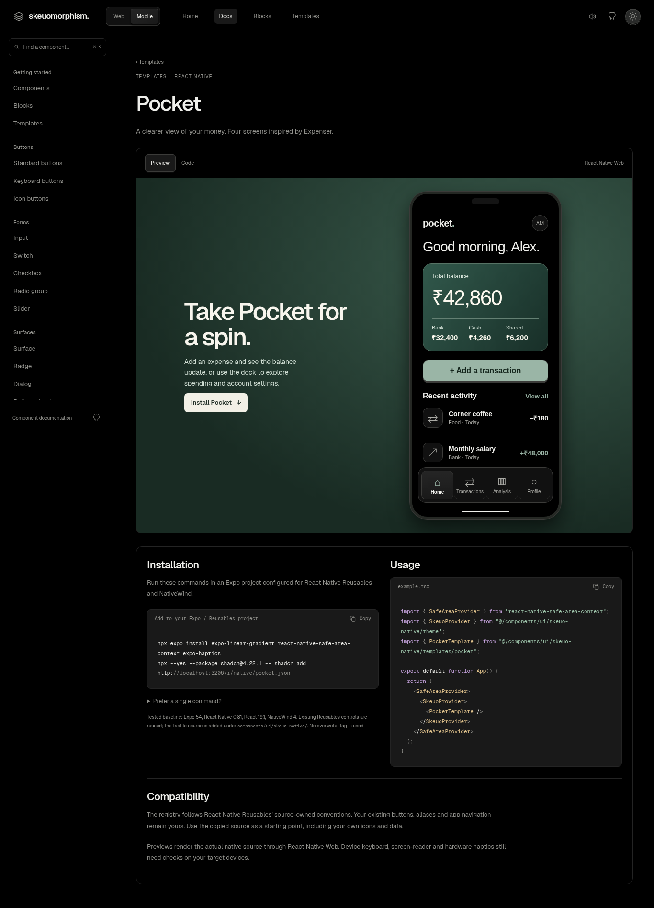](docs/mobile-redesign/report/pocket-laptop-dark.png) |
| Mobile | [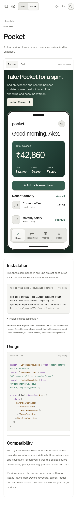](docs/mobile-redesign/report/pocket-mobile-light.png) | [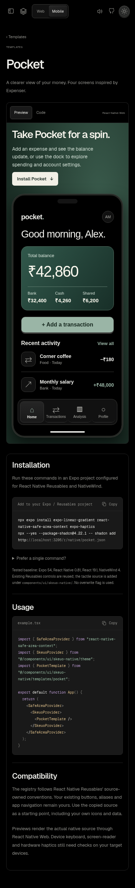](docs/mobile-redesign/report/pocket-mobile-dark.png) |

### Badge

`/docs/mobile/badge`

| Viewport | Light | Dark |
| --- | --- | --- |
| Laptop | [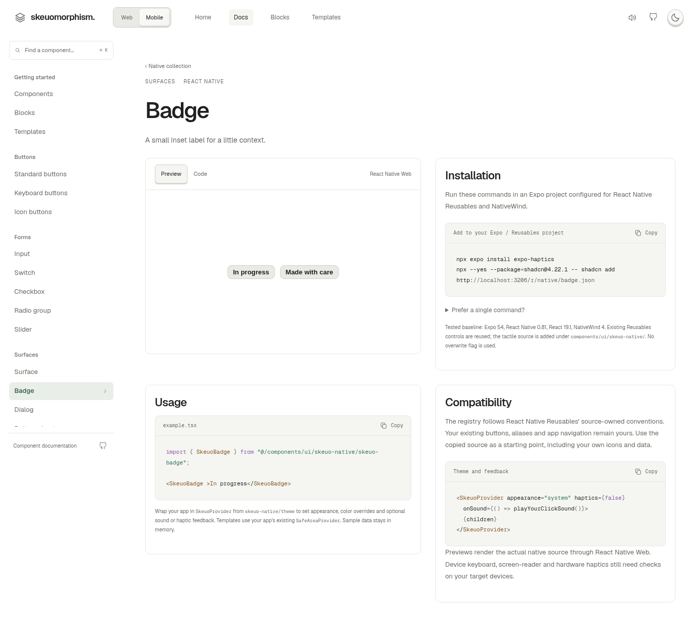](docs/mobile-redesign/report/badge-laptop-light.png) | [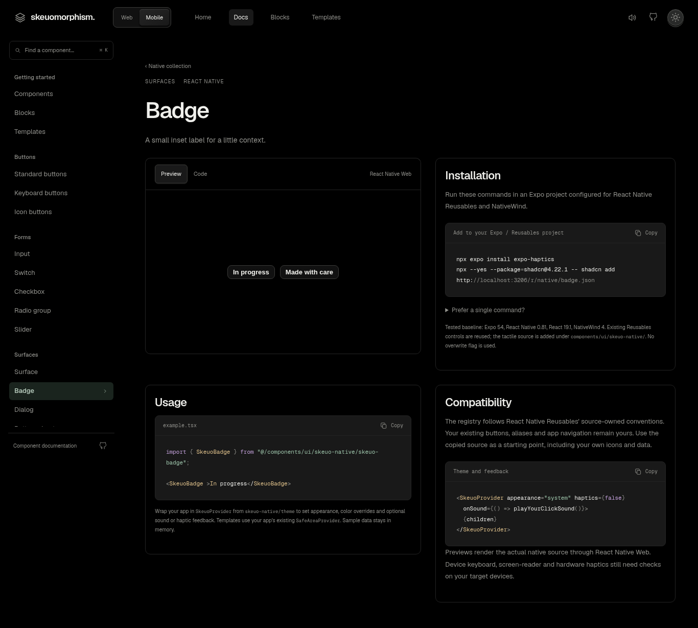](docs/mobile-redesign/report/badge-laptop-dark.png) |
| Mobile | [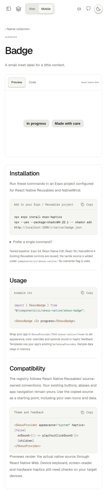](docs/mobile-redesign/report/badge-mobile-light.png) | [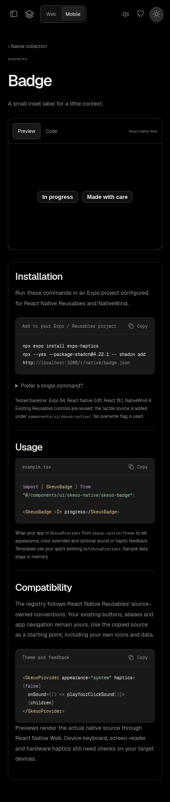](docs/mobile-redesign/report/badge-mobile-dark.png) |

## Verification

- The production build passed. Chromium checked 57 pages at 320, 390, 768, and 1366 px, with no page-level horizontal overflow across 228 checks.
- The browser suite exercises the 26 live native previews, Web/Mobile navigation, Preview and Code, the Pocket transaction flow, and light/dark synchronization.
- In a fresh Expo 54 project configured for React Native Reusables and NativeWind, Pocket installed using the documented Expo command and shadcn 4.22.1. The CLI reused the existing Reusables Button and Text files. The consumer passed TypeScript and Metro exports for iOS, Android, and web.
- Native hardware testing remains open. The existing Next.js build reports a security upgrade advisory.
